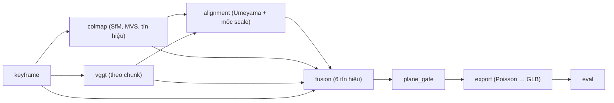

# 3DMeph — Metric 3D Indoor Reconstruction từ smartphone RGB video

GVHD: Lê Thị Vĩnh Thanh · Nhóm 4 người · Đồ án 2026

Đây là README chung của dự án. Mỗi module trong `pipeline/` có README riêng ghi quy trình, công thức,
tham số và test của module đó; README gốc chỉ nêu bức tranh chung và trỏ tới chúng.

Tài liệu thiết kế gốc: `Docs/TaiTao3D_Metric_3DMeph.pdf` (bản Revised 10/2026, 52 trang vật lý) nằm trong thư mục
làm việc `3D_Metric/`, ngoài repo. Các README trích dẫn theo **ĐC §x** (mục) và **(n)** (số công thức) của file đó.

## 1. Bài toán và mục tiêu

Quay video 1–2 phút trong một phòng. Hệ thống trả về mô hình 3D có đơn vị **mét**; người dùng chọn hai điểm
trên mô hình và nhận khoảng cách. **Mục tiêu đo:** sai số trung vị dưới 5 cm cho phòng 3–5 m, sau một lần neo
scale bằng một đoạn dài 1–2 m (ĐC trang 1). Đây là mục tiêu thử nghiệm, chưa phải kết quả.

Cả COLMAP lẫn VGGT đều không tự cho ra mét (ĐC §2): bỏ bước neo scale thì app đọc "0,688" thành 0,688 m,
sai gần gấp đôi so với 1,40 m.

## 2. Pipeline

Hai nhánh độc lập (COLMAP hình học và VGGT học sâu) được căn về cùng hệ toạ độ, đổi sang mét, ghép bằng
trọng số sáu tín hiệu, rồi làm phẳng có cổng.



| Node trong `3dmeph-dataflow.html` | Module | README phụ |
|---|---|---|
| Keyframes Input | `pipeline/keyframe/` | [keyframe](pipeline/keyframe/README.md) |
| COLMAP SfM, COLMAP MVS, SfM Output | `pipeline/colmap/` | [colmap](pipeline/colmap/README.md) |
| VGGT Inference, VGGT Output | `pipeline/vggt/` | [vggt](pipeline/vggt/README.md) |
| Scale Alignment | `pipeline/alignment/` | [alignment](pipeline/alignment/README.md) |
| Confidence Fusion | `pipeline/fusion/` | [fusion](pipeline/fusion/README.md) |
| Plane-Gated Filter | `pipeline/plane_gate/` | [plane_gate](pipeline/plane_gate/README.md) |
| GLB Mesh Output | `pipeline/export/` | [export](pipeline/export/README.md) |
| *(ngoài dataflow)* Eval | `pipeline/eval/` | [eval](pipeline/eval/README.md) |
| *(dùng chung)* cấu hình, hình học, chất lượng ảnh | `pipeline/common/` | [common](pipeline/common/README.md) |

Các sơ đồ gốc: [dataflow](../PipelineFlowChart/3dmeph-dataflow.html), [architecture](../PipelineFlowChart/3dmeph-architecture.html),
[training pipeline](../PipelineFlowChart/3dmeph-training-pipeline.html) (thư mục `PipelineFlowChart/` nằm ngoài repo).

**Khi đọc sơ đồ dataflow, lưu ý (mặc định theo đề cương, chưa sửa HTML):**
- Fusion cần thêm bốn đường vào (`c_model`, `e_reproj`, `σ_depth` và ba `q_*` từ ảnh); sơ đồ chỉ vẽ một.
- Căn hệ toạ độ dùng **tâm camera** (ĐC §15.1), không dùng depth map; cần thêm đường vào cho mốc scale `s_m`.
- Điểm không qua cổng plane gate **vẫn nằm trong kết quả** (ĐC Hình 20); cổng gồm `r_k, θ_k, s_k, w_k` (24),
  không phải "inlier ratio, depth continuity".
- Trọng số thô là `w` (19), chuẩn hóa là `w̃` (22); thang đổi sai số là `τ_e, τ_σ`.

## 3. Cấu trúc repo

```
3DMeph/
├─ pipeline/        lõi kỹ thuật, mỗi module có README riêng (bảng trên)
├─ configs/         default.yaml, mọi tham số cần khoá (xem configs/README.md)
├─ scripts/         chuẩn bị dữ liệu: validate, explore, chọn và chia scene, tải, căn Faro, chấm đoạn đo
├─ environment/     requirements nền, create_env.bat, check_env.py
├─ tests/           pytest, test vector lấy từ đề cương
├─ data/            raw/ (ARKitScenes, Replica), scenes/ (cây Mục 9), splits.csv
├─ outputs/         chỉ còn eval_results/ (bảng tổng hợp chéo scene)
├─ reports/         thống kê EDA, hình
├─ app/             backend FastAPI và Unity (ngoài mốc đầu)
└─ docs/            khoá luận .docx và hình
```

**Cây một scene** (ĐC §9), tại `data/scenes/<dataset>/<scene_id>/`; không copy và không ghi đè raw:

```
raw/  frames/{candidates,keyframes}/  metadata/  ground_truth/  baselines/{colmap,vggt}/
proposed/{alignment,fusion,plane_refinement,export}/  evaluation/{metrics.csv,figures,logs}
```
`proposed/alignment/`, `proposed/export/` và `ground_truth/faro/` không có trong đề cương, nhóm thêm vào.

## 4. Dữ liệu

Ba nguồn, ba bảng số riêng, không trộn kết quả (ĐC §3).

| Nguồn | Vai trò | Hiện có |
|---|---|---|
| ARKitScenes (subset có laser Faro) | train / validation / held-out nội bộ | 40 scene thật: 34 `Training` + 6 `Validation` trong `data/raw/arkitscenes/`, thuộc 38 venue. RGB `lowres_wide` 256×192 đã có; `vga_wide` 640×480 đã tải cho scene dev 42444738 và 6 Validation (18/10/2026); Faro đã tải cho scene dev và 6 Validation, chưa tải cho 5 held-out |
| Replica | test, chạy một lần | 18 scene = 13 không gian độc lập (6 `frl_apartment` là một); chỉ có `mesh.ply` + `textures/`, **thiếu** `preseg`, `semantic`, `glass.sur` (ĐC §11) |
| Tự thu bằng điện thoại | cross-domain, đo ngoài đời | chưa có (6–8 phòng, ĐC §5) |

- **Danh sách scene lấy từ thư mục thật và `metadata.csv`**, không dùng `selected_scenes.csv` (file đó lệch: 2 dòng
  không có trên đĩa, 6 scene Validation không nằm trong file). Chi tiết ở [data/README.md](data/README.md).
- **Chia tập (đã sinh ở M0b, `data/splits.csv` + `splits.lock`):** 29 train / 6 val / 5 held-out, chia theo `visit_id` (venue),
  seed 42; lệch nhỏ so với 30/5/5 của ĐC Hình 9. `V_ref`, `G_ref`, `τ_e`, `τ_σ` và các ngưỡng khoá trên 6 scene Validation;
  held-out chạy đúng một lần (mã tính tham số `raise` khi gặp scene held-out).
- `sky_direction` của ARKitScenes (Left, Up, Down) cho biết hướng ảnh; keyframe xoay ảnh về dạng đứng.

## 5. Cài đặt môi trường

Môi trường conda `3d_metric` (Python 3.12, torch 2.5.1+cu121, RTX 4060 8 GB). Dựng mới hoặc cập nhật:

```bash
# skip (cài gói, mất thời gian): chạy trong Anaconda Prompt
environment\create_env.bat
```

Xem [environment/README.md](environment/README.md). Hai điều cần nhớ:
- **`import torch` phải đứng trước `pycolmap`**: nếu `open3d` hoặc `cv2` được nạp trước, `import pycolmap` lỗi
  "DLL load failed". Gói `pipeline` tự làm việc này; script riêng phải import qua `pipeline`.
- COLMAP chạy bằng CLI 4.2 (`colmap/bin/colmap.exe` cạnh repo, hoặc biến `COLMAP_EXE`); pycolmap 3.10 chỉ đọc model
  và căn Sim(3).

Kiểm tra môi trường (chỉ đọc):

```bash
# check
python environment/check_env.py
```

## 6. Quick start

Những gì chạy được ở M0a (chưa có stage chạy trên dữ liệu thật):

```bash
# check
python -m pipeline.export.measure --a 0.52 0.75 1.20 --b 1.90 0.75 1.20
```
```bash
# skip (cần pytest, vài giây)
python -m pytest tests -q
```
```bash
# check
python scripts/check_docs.py --help
```

Lệnh chạy một scene từ keyframe tới GLB (`python -m pipeline.run --scene arkitscenes/<video_id>`) **chưa có**;
dự kiến ở M1. Tên stage: `keyframe, sfm, mvs, vggt, align, fuse, gate, export, eval`.

## 7. Trạng thái và lộ trình

Tổng thời gian đề cương: 9 tuần; cách chia tuần dưới đây là ước tính của nhóm (đề cương chỉ nêu tổng và ưu tiên
tuần đầu: một scene chạy xuyên suốt, chưa train confidence head, ĐC §25).

| Mốc | Nội dung | Trạng thái |
|---|---|---|
| M0a | môi trường, `default.yaml`, `common/`, lõi toán các module và test, README, sửa lỗi repo | có |
| M0b | chọn và chia scene, tải `vga_wide` và Faro, căn Faro, chấm mốc scale và đoạn test, đo `V_ref`, `G_ref` | đang làm: xong chia scene, tải, `V_ref`/`G_ref`, căn Faro scene dev; còn chấm mốc và đoạn test |
| M1 | cả chín stage chạy một lệnh trên scene 42444738 (CLI, chưa FastAPI/Unity) | chưa |
| M2 | khoá ngưỡng keyframe trên Validation, đo VRAM và tỷ lệ đăng ký SfM | chưa |
| M3 | `eval/` đủ chỉ số; B0, B1, B3, Proposed, Ablation 1–2 trên một scene | chưa |
| M4 | nhiều scene ARKit: val khoá ngưỡng, held-out chạy một lần | chưa |
| M5 | Replica (render, nhãn), tự thu pilot | chưa |
| M6 | FastAPI + Unity, báo cáo | chưa |

Mục tiêu đánh giá (ĐC §21): median < 5 cm; giảm 15–20% plane error mà F-score không giảm đáng kể. Không đạt thì báo
số thật, phân tích nguyên nhân.

## 8. Quy trình nhóm

Xem [CONTRIBUTING.md](CONTRIBUTING.md): mỗi việc một nhánh `feature/<tên>`, mở PR vào `main`, cần ít nhất một approve.
`CODEOWNERS` gợi ý reviewer theo thư mục (đang dùng `@username1–4`, chưa thay bằng tên GitHub thật). Trước khi mở PR:
`pytest` xanh và `python scripts/check_docs.py` xanh.

## 9. Tài liệu và bài báo

`Docs/` (đề cương PDF, sơ đồ) và `Papers/` (bài báo gốc kèm bản dịch tiếng Việt) trong thư mục làm việc `3D_Metric/`.
Bài cốt lõi: ARKitScenes, Replica, VGGT, COLMAP SfM/MVS, GGPT, UniDepthV2, PlanarSplatting (ĐC §22). File
`Papers/Umeyama.pdf` là bài khác (ghép đồ thị Gaussian), không phải bài gốc 1991 (IEEE TPAMI 13(4)); cần thêm bài gốc.

## 10. Giới hạn đã biết

- `V_ref` = 205,69 và `G_ref` = 29,01 đã đo trên `vga_wide` của 6 Validation (18/10/2026); số 581 trong đề cương đo trên `lowres_wide` 256×192 và gồm cả scene sẽ làm held-out, nên
  không dùng làm cấu hình (chỉ xuất hiện như ví dụ trong test).
- Replica thiếu nhãn phẳng/ngữ nghĩa; Habitat-Sim chưa cài (khả năng cài trên Windows chưa kiểm chứng). Hoãn đến M5.
- Đề cương không nêu cách nối chunk VGGT cho baseline B1, cách đổi confidence VGGT sang [0,1], định nghĩa `w_k` trong
  cổng, nhãn `s_k` khi không có ngữ nghĩa: nhóm đã chọn và ghi rõ trong README từng module (nhãn "Suy luận").
- `*_3dod_mesh.ply` trong thư mục scene là mesh ARKit, **không phải** laser Faro. Faro là
  `laser_scanner_point_clouds` (đã tải cho scene dev và 6 Validation).
- Plane gate trên dataflow HTML khác đề cương (xem mục 2); mặc định theo đề cương.
