> Bản sao NGUYÊN VĂN kế hoạch v4 (tạo ở chế độ Plan của Claude Code, 17/10/2026) để mọi agent đọc được.
> Kế hoạch là nguồn ưu tiên (b) trong AGENTS.md. Trạng thái thực tế và chỗ lệch so với kế hoạch: xem WORKING_LOG.md.
> Các câu "chưa sửa file nào, chưa tải gì" ở đầu kế hoạch mô tả thời điểm lập kế hoạch, không phải trạng thái hiện tại.

# Kế hoạch v4: pipeline 3DMeph end-to-end (mốc đầu) + README + môi trường

**Chưa viết code, chưa sửa file nào trong repo, chưa tải gì.** Chỉ có file kế hoạch này, vài file tạm trong scratchpad và các lệnh đọc (kể cả HEAD request để đo dung lượng và vài request Range cỡ vài MB để so sánh file Faro).

## Nhật ký thay đổi v4 (đánh dấu `[v4]` trong thân kế hoạch)

| # | Đổi gì | Ở đâu |
|---|---|---|
| 1 | Chốt Q15 = **29/6/5**, Q17 = **seed 42**, Q18 = **tải cả 6 file Faro**, Q20 = **M1 đợi đợt C** (không dùng `V_ref` tạm), Q16 = **duyệt cả 3 đợt A, B, C** (mỗi đợt vẫn `--dry-run` trước) | §0, §4.0b, §4.0c, §11 |
| 2 | Kiểm Faro bằng HTTP Range: 3 cặp cùng kích thước, cùng `_pose.txt`, cùng xyz (100.000 điểm đầu), chỉ khác RGB và `quality`. Dù tải cả 6, `faro_align.py` chỉ dựng GT từ 1 file mỗi cặp pose trùng để không đếm đôi điểm | §4.0c, §4.0d |
| 3 | Thông tin PLY và pose của Faro đã đo: 42.348.620 điểm/scan, 44 B/điểm, hệ chung Z-up, `_pose.txt` 4 dòng với tịnh tiến ở dòng cuối | §4.0d |
| 4 | **Thứ tự mốc đổi:** M1 chỉ bắt đầu sau khi M0b xong (đợt A, B, C, căn Faro, `V_ref`/`G_ref` trên `vga_wide`); M1 chạy trên `vga_wide`; bỏ khoá `lowres` khỏi config | §4.1, §4.9, §10 |

## Nhật ký thay đổi v3 (đánh dấu `[v3]` trong thân kế hoạch)

| # | Đổi gì | Ở đâu |
|---|---|---|
| 1 | Liệt kê thư mục Training thật, đối chiếu `selected_scenes.csv`, báo scene lệch. Nguồn chính = thư mục thật + `metadata.csv` | §4.0a, §4.0b, §7c |
| 2 | Chia tập **29 train / 6 val / 5 held-out** (6 Validation làm val; held-out chọn từ Training theo venue, khoá); phương án 30/5/5 | §4.0b, §6, Q15 |
| 3 | `V_ref`, `G_ref`, `τ_e`, `τ_σ`, ngưỡng blur/overlap khoá trên **6 Validation, `vga_wide`**; bỏ số 581 | §4.1, §6, §4.9 |
| 4 | Tải dữ liệu 3 đợt, dung lượng **đo bằng HEAD**, chờ bạn xác nhận từng đợt. Phát hiện 2 bẫy của `download_data.py` (tự `unzip`, thêm cấp `raw/`) | §4.0c, Q16 |
| 5 | Trả lời Q1–Q14 | §11 |
| 6 | Chấm chiều dài: bán kính snap **2 cm**; ưu tiên chọn đầu mút **trực tiếp trên point cloud mô hình**; căn tự động chỉ cho chạy hàng loạt và phải ghi sai số căn | §4.8, §1 hàng 17 |
| 7 | Tách **M0a** (môi trường, config, common, README) và **M0b** (chia scene, tải dữ liệu, căn Faro, chấm anchor và đoạn test) | §10 |
| 8 | Thêm rủi ro: Faro ~11 GB cho 1 scene, RAM 15,7 GB, `unzip`/cấu trúc thư mục khi tải | §9 |

## 0. Cơ sở và quyết định đã chốt

**Nguồn đã đọc đủ:** PDF `Docs/TaiTao3D_Metric_3DMeph.pdf` (52 trang vật lý, 47 là số trang cuối của phần thân; trích bằng `pdftotext` vì `Read` không render được PDF). Cả 3 file HTML trong `PipelineFlowChart/` (đọc qua SVG và JSON; 11 mũi tên của dataflow khớp JSON). Mọi README, `CONTRIBUTING.md`, `CODEOWNERS`, `.gitignore`, PR template, `eda_stats.csv`, `validation_report.csv`, 3 script, mã VGGT (`head_act.py`), `download_data.py` của ARKitScenes.

**Nhãn:** `[ĐC §x]` = từ đề cương mục x / công thức (n). `[Suy luận]` = tôi suy ra, đề cương không nêu. `[Cần xác nhận]` = cần bạn gật đầu. "Chưa có căn cứ" = không có số trong nguồn. `[v3]` = đổi so với bản v2.

**Quyết định đã chốt:**

| Vấn đề | Chốt |
|---|---|
| Phạm vi mốc đầu | CLI chạy 1 scene ARKitScenes, fusion theo luật. Không FastAPI, Unity, train head |
| Scene mốc đầu (Q1) | **42444738** (Training, `sky=Left`, visit 421267) |
| Mesh và gate | RANSAC + hướng pháp tuyến; Poisson (Open3D) + trimesh → GLB |
| `w_k` trong cổng (24) | `w_k = Σ_i w̃_{i,k}·w_{i,k}` |
| Điểm `k` | Điểm MVS dày (`fused.ply.vis` cho biết view nào thấy). Ghép dự đoán VGGT; COLMAP chỉ cho tín hiệu |
| Hướng trọng lực, nhãn `s_k` | Xoay ảnh theo `sky_direction`, "lên" = (0,−1,0) trong camera, tinh chỉnh bằng mặt phẳng ngang lớn nhất trong 20° |
| Chọn scene | Thư mục thật + `metadata.csv`: `has_laser_scanner_point_clouds=True`, `visit_id` hợp lệ, chia theo `visit_id`. **`selected_scenes.csv` không phải danh sách chính** [v3] |
| Chia tập [v4] | **29 train / 6 val / 5 held-out** (Q15); held-out chọn từ Training theo venue, **seed 42** (Q17), khoá |
| `V_ref`, `G_ref` [v3] | Đo lại trên `vga_wide` của 6 Validation (ĐC §16.1: `G_ref` từ validation). **Không dùng 581** |
| Mốc scale ARKit | Click 2D ≥2 keyframe, tam giác hóa bằng camera COLMAP (Q3). Laser Faro chỉ cho mốc, đoạn test, Chamfer/F-score; pipeline không phụ thuộc Faro |
| `c_model` | `c = 1 − 1/conf` (VGGT trả `conf = 1+exp(x)` ∈ [1,∞), `head_act.py:103`) |
| RGB | `vga_wide` 640×480 cho kết quả; `lowres_wide` 256×192 cho chạy thử nhanh |
| COLMAP | CLI 4.2 cho SfM+MVS; pycolmap 3.10 chỉ đọc model và căn Sim(3) |
| Cây thư mục (Q2) | **Theo Mục 9** |
| HTML dataflow (Q5) | Không sửa |
| README | Tiếng Việt, thuật ngữ kỹ thuật giữ tiếng Anh; người phụ trách giữ `@username1–4` |
| Tải dữ liệu [v4] | Duyệt cả 3 đợt (Q16): A 0,74 GB; B 10,98 GB (cả 6 file Faro, Q18); C 10,23 GB. Mỗi đợt chạy `--dry-run` trước |
| Thứ tự M1 [v4] | M1 đợi đợt C (Q20); không dùng `V_ref` tạm |

## 1. Bảng thay đổi (cũ → mới → căn cứ)

| # | Mục | Kế hoạch cũ | Kế hoạch mới | Căn cứ |
|---|---|---|---|---|
| 1 | Input của alignment | Point map | **Tâm camera** `x_i` (VGGT) ↔ `y_i` (COLMAP); RANSAC rồi Umeyama; **mỗi chunk một lần** | ĐC §15.1 (13)–(17), Hình 16–17, ví dụ "12 cặp tâm camera của chunk 1". Mỗi chunk VGGT có gốc là camera đầu của chính nó (§13 cảnh báo) |
| 2 | `sfm_signals.npz` theo điểm 3D | Một giá trị cho mỗi điểm 3D | Lưu **theo quan sát (i,k)**: `e_reproj` từng cặp (view, điểm); `σ_depth` và `c_model` dạng bản đồ theo view | ĐC §16, bảng §16.1 (chỉ số i,k), §23, §14.4 (COLMAP không xuất sẵn) |
| 3 | Config | `lambda_r`, `lambda_d` | `tau_e` (2 px), `tau_sigma` (0,20 m), `v_ref`, `g_ref`, `dark_px=5`, `bright_px=250`, `tau_r`, `tau_n`, `tau_w`, `plane.alpha`, `loss.alpha_r`, `chunk`, `overlap` | (19), (20), (21), (24), (25), (29), (2). Hai hệ số `α` khác nhau: (25) kéo phẳng, (29) phạt `L_reg` |
| 4 | Thư mục chạy | `outputs/runs/<scene>/` tự đặt | **Cấu trúc Mục 9** (§3). **Đã chốt Q2 = Có** [v3]: bỏ `outputs/{colmap_runs,vggt_runs,fused_meshes}`, giữ `outputs/eval_results` cho bảng tổng hợp chéo scene | ĐC §9 |
| 5 | Eval | Chỉ MAE, median, Chamfer | Đủ: MAE, median, **MAPE, %<5 cm**, Acc, Comp, Chamfer, F_δ (δ=5 cm), P2Plane, **PlaneRecall**, **ATE sau Sim(3)**, runtime, peak VRAM; **trung bình theo không gian** (Replica); B0, B1, B3, Proposed, Ablation 1, Ablation 2 (B2 là mục tiêu mở rộng) | (7), (31)–(37), §20 Hình 26, §21 |
| 6 | Replica | Chỉ nói "eval" | Thêm bước **render Habitat-Sim** và protocol đo chiều dài (chọn 2 đầu mút trên mesh, đo theo (30)). **Hoãn (Q6)** | ĐC §11 Hình 11, cảnh báo (1)(2); §8.3 |
| 7 | Mốc scale | "Khoảng cách 2 camera" | **1 đoạn 1–2 m**, dễ thấy, không trên gương/kính, `used_as_anchor=1`, loại khỏi chỉ số test | ĐC §8.1 (4), §8.3, §9; cảnh báo "ví dụ sai" §8.1 |
| 8 | Unity | Có trong lộ trình | Thay bằng **script đo 2 điểm** `‖B−A‖` theo (30). Bỏ Unity, FastAPI khỏi mốc đầu | ĐC §19.1, Hình 25, Hình 30 (PDF gồm Unity; lệch có chủ ý) |
| 9 | Plane gate | 4 điều kiện của dataflow | Theo **PDF (24)**: `r_k<τ_r`, `θ_k<τ_n`, `s_k∈S_struct`, `w_k>τ_w`. Điểm không qua cổng **giữ nguyên**, vẫn nằm trong GLB | §2c |
| 10 | Lỗi repo | (a)–(e) trong brief | Đã kiểm chứng cả 5, thêm lỗi mới (§7c) | §7c |
| 11 | Hướng "lên" | Chưa có | Xoay ảnh upright theo `sky_direction`, cập nhật intrinsics; gravity=(0,−1,0) rồi tinh chỉnh | Quyết định của bạn; đã xem ảnh scene 42444738 (`sky=Left`): đầu người trong khung ảnh nằm bên trái, khớp phép xoay 90° CW |
| 12 | Mesh GT | `*_3dod_mesh.ply` coi là Faro | **Không phải Faro**: đó là mesh ARKit/iPad cho 3DOD (`download_data.py:39`). Faro là `laser_scanner_point_clouds` (.ply + `_pose.txt`) | `download_data.py:83–136`, ARKitScenes `DATA.md:92` |
| 13 | Asset RGB và `V_ref` [v3] | `lowres_wide`, `V_ref=581` | `vga_wide` cho kết quả. **Bỏ 581**: đo trên `lowres_wide` 256×192 và gồm cả scene sẽ làm held-out. Đo lại `V_ref`, `G_ref` trên `vga_wide` của **6 Validation** | `explore_dataset.py:40`, `validation_report.csv` (40/40 = 256x192); ĐC §16.1 |
| 14 | Định nghĩa còn trống | Bỏ ngỏ | `w_k`, `k`, `c_model`, nhãn `s_k`: đã chốt (§0) | Quyết định của bạn |
| 15 | GLB | "Poisson" | Giữ; PDF không quy định, đây là quyết định của bạn. Xoay thế giới về **+Y là lên** khi ghi GLB [Suy luận] | ĐC §19 "GLB đã ở mét" |
| 16 | Chia tập [v3] | 30/5/5 như PDF Hình 9 | **29 train / 6 val / 5 held-out** từ thư mục thật, **đã chốt Q15** [v4] | ĐC Hình 9, §10, §12; dữ liệu thật §4.0a |
| 17 | Chấm chiều dài [v3] | Snap 5 cm, căn tự động | **Snap 2 cm**; ưu tiên chọn đầu mút trực tiếp trên point cloud mô hình; căn tự động chỉ cho chạy hàng loạt và ghi sai số căn | ĐC §8.3 ("dán sticker ở hai đầu mỗi đoạn để chọn lại đúng vị trí trên point cloud/mesh") |
| 18 | Cách tải [v3] | Gọi `download_data.py` | Wrapper riêng, không giải nén, tải theo 3 đợt có xác nhận | §4.0c |

## 2. Ánh xạ dataflow → module (1-1)

**Tên stage CLI:** `keyframe, sfm, mvs, vggt, align, fuse, gate, export, eval`.

### 2a. Node → module

| Node trong `3dmeph-dataflow.html` | Module `pipeline/…` | Đầu vào | Đầu ra | Công thức PDF |
|---|---|---|---|---|
| Keyframes Input (RGB frames + scale) | `keyframe/` | `raw/` (ARKit zip), `source.json` (`sky_direction`), `ground_truth/scale_anchor.json` | `frames/keyframes/*.jpg`, `metadata/keyframes.csv`, `metadata/camera.json` | (1), (2), (3), (20) |
| COLMAP SfM | `colmap/sfm.py` | `frames/keyframes/`, `camera.json` | `baselines/colmap/sfm/sparse/0/`, `observations.npz` | (9)–(11) |
| COLMAP MVS | `colmap/mvs.py` | `sparse/0/`, ảnh | `baselines/colmap/mvs/` (depth photometric + geometric, `fused.ply`, `fused.ply.vis`) | (12) |
| SfM Output | `colmap/signals.py` | hai thư mục trên | `e_reproj_obs.npz` (theo (i,k)), `e_reproj_map/*.npy` (nội suy dày), `sigma_depth/*.npy` | §14.4 |
| VGGT Inference | `vggt/infer.py` | `frames/keyframes/` theo chunk | `baselines/vggt/chunk_XX/vggt_raw.npz` | (8), (2) |
| VGGT Output | `vggt/outputs.py` | `vggt_raw.npz` | `c_model` ∈ [0,1), `points_chunk` (unproject từ depth) | §13 |
| Scale Alignment | `alignment/` | tâm camera VGGT, `sparse/0`, `scale_anchor.json` | `proposed/alignment/chunk_XX_sim3.json`, `scale.json` (`s_m`) | (13)–(18), (4) |
| Confidence Fusion | `fusion/` | `fused.ply.vis`, `points_metric`, 6 tín hiệu | `proposed/fusion/fused_points.ply` (có `w_k`), `fusion_log.npz` | (19)–(22) |
| Plane-Gated Filter | `plane_gate/` | `fused_points.ply` | `proposed/plane_refinement/refined_points.ply`, `planes.json`, `gate_log.csv` | (23)–(25) |
| GLB Mesh Output | `export/` | `refined_points.ply` | `proposed/export/model.glb`, `measurements.json` | (30); Poisson ngoài PDF |
| *(ngoài dataflow)* Eval | `eval/` | các đầu ra trên, GT | `evaluation/metrics.csv` | (31)–(37), (7) |

### 2b. 11 mũi tên → file hợp đồng

| # | Mũi tên (nhãn trong HTML) | File hợp đồng | PDF đòi gì |
|---|---|---|---|
| 1 | keyframes → colmap_sfm ("video frames") | `frames/keyframes/*.jpg` + `camera.json` | COLMAP chạy **cả** keyframe [ĐC §7] |
| 2 | keyframes → vggt ("video frames") | cùng file, chia chunk | VGGT chạy theo chunk `c=8–16`, gối `o=2` [ĐC §7.1] |
| 3 | colmap_sfm → colmap_mvs ("poses") | `sparse/0/{cameras,images,points3D}.bin` | camera đã biết → MVS [ĐC §14] |
| 4 | colmap_sfm → sfm_output ("3D pts · e_reproj") | `observations.npz` | `e_reproj` tính theo (i,k) |
| 5 | colmap_mvs → sfm_output ("dense depth") | `mvs/` + `sigma_depth/` | `σ_depth` = chênh photometric vs geometric |
| 6 | vggt → vggt_output ("depth · c_model") | `vggt_raw.npz` | depth, conf, camera [ĐC §13] |
| 7 | sfm_output → scale_align ("pts · poses") | `sparse/0` | **tâm camera** `y_i` |
| 8 | vggt_output → scale_align ("depth map") | camera extrinsic | **tâm camera** `x_i`, không phải depth map |
| 9 | scale_align → conf_fusion ("aligned scale") | `chunk_XX_sim3.json` + `scale.json` | `s,R,t` và `s_m`, điểm đã ở mét |
| 10 | conf_fusion → plane_gate ("weighted pts") | `fused_points.ply` (xyz, `w_k`) | `P̂_k` và `w_k` |
| 11 | plane_gate → glb_output ("refined cloud") | `refined_points.ply` | điểm sau (25) |

### 2c. Mâu thuẫn dataflow ↔ PDF (mặc định theo PDF; không sửa HTML, Q5)

1. **Fusion chỉ nhận 1 mũi tên** (`aligned scale`). Theo PDF Hình 18 và 29, fusion cần `c_model`, `e_reproj`, `σ_depth` và 3 `q_*` (từ ảnh). **Thiếu 4 mũi tên**: sfm_output→fusion, vggt_output→fusion, mvs→fusion, keyframes→fusion.
2. **Mũi tên 8** ghi "depth map"; PDF dùng tâm camera cho Umeyama.
3. **Thiếu mốc scale `s_m`**: dataflow chỉ có "RGB frames + scale" ở node đầu, không có đường vào alignment. PDF Hình 1: bước D "Umeyama + đổi mét".
4. **Card Fusion** dùng `λ_r, λ_d` và `w̃` cho trọng số thô. PDF dùng `τ_e, τ_σ`, trọng số thô là `w` (19), chuẩn hóa mới là `w̃` (22).
5. **Card Plane-Gated** liệt kê "residual · inlier ratio · normal consistency · depth continuity" và nói "chỉ điểm qua gate mới vào GLB". PDF (24): `r_k, θ_k, s_k, w_k`; điểm không qua cổng **giữ nguyên** (Hình 20 "gk = 0 giữ nguyên điểm"). "Inlier ratio" và "depth continuity" không có trong PDF.
6. **Tiêu đề cột** lệch nội dung: cột "03 Hợp nhất" chứa 2 node Output; cột "04 Lọc & Xuất" chứa Scale Alignment và Confidence Fusion; cột "05 Kết quả" chứa Plane Gate và GLB.
7. **`3dmeph-training-pipeline.html`** (ngoài mốc đầu): ghi VGGT cho "metric depth" (PDF §13: chưa mét); dùng "Replica Mesh GT" trong loss (PDF §18, §12: `L_p2s` dùng laser ARKitScenes, Replica chỉ test); `scale_align` đứng sau confidence head (PDF Hình 22: trước fusion).
8. **`3dmeph-architecture.html`** (ngoài mốc đầu): `POST /reconstruct` và Redis; PDF §19 là `POST /jobs`, `GET /jobs/{id}`, không nhắc Redis.

## 3. Luồng dữ liệu, cấu trúc thư mục, schema

```mermaid
flowchart LR
  RAW["raw (ARKit zip, sky_direction)"] --> KF["keyframe<br/>xoay upright, lọc, q_blur, q_exposure"]
  KF -->|"keyframes/*.jpg + camera.json + keyframes.csv"| SFM["colmap sfm"]
  KF -->|"cùng ảnh, chia chunk c=12,o=2"| VG["vggt"]
  SFM -->|"sparse/0"| MVS["colmap mvs"]
  SFM -->|"observations.npz (e_reproj theo i,k)"| SIG["colmap signals"]
  MVS -->|"depth photometric/geometric, fused.ply.vis"| SIG
  VG -->|"vggt_raw.npz (extrinsic, depth, conf)"| VO["vggt outputs<br/>c_model = 1-1/conf"]
  SIG -->|"tâm camera y_i"| AL["alignment<br/>Umeyama+RANSAC mỗi chunk; s_m"]
  VO -->|"tâm camera x_i"| AL
  ANC["scale_anchor.json (1–2 m)"] --> AL
  AL -->|"sim3.json, scale.json, points_metric"| FU["fusion<br/>w, w~, P^, w_k"]
  SIG -->|"e_reproj map, sigma_depth (đổi sang m)"| FU
  VO -->|"c_model"| FU
  KF -->|"q_blur, q_exposure; q_texture tính tại (i,k)"| FU
  FU -->|"fused_points.ply (xyz, w_k)"| PG["plane_gate<br/>RANSAC + hướng lên"]
  PG -->|"refined_points.ply, planes.json"| EX["export<br/>Poisson → GLB"]
  EX --> OUT["model.glb + measurements.json"]
  OUT --> EV["eval"]
```



Các stage chỉ giao tiếp qua file. GPU 8 GB (đo ngày 17/10: 7.948 MiB trống) không phải giữ VGGT và COLMAP cùng lúc.

**CLI:** `python -m pipeline.run --scene <dataset>/<scene_id> --config configs/default.yaml [--from-stage X --to-stage Y] [--variant B0|B1|B3|proposed|abl_quality|abl_gate]`. Mỗi stage ghi `run_meta.json` (thời gian, peak VRAM, hash config, mã lỗi). Mã lỗi theo Hình 24: `E_TOO_FEW_KEYFRAMES` (dưới 40, ngưỡng PDF §7), `E_SFM_FAILED`.

**Cây thư mục một scene (Mục 9, Q2 đã chốt):** `data/scenes/arkitscenes/<video_id>/`
```
raw/                 source.json (đường dẫn tới data/raw/..., sky_direction, visit_id). KHÔNG copy zip, KHÔNG ghi đè raw
frames/              candidates/, keyframes/
metadata/            camera.json, conditions.json, keyframes.csv, imu.csv (chỉ tự thu)
ground_truth/        scale_anchor.json, measurements.csv, room_sketch.png, faro/ (con trỏ + ma trận căn) [thư mục faro/ ngoài PDF]
baselines/           colmap/{sfm,mvs,metric}, vggt/{chunk_XX,metric}
proposed/            alignment/ [ngoài PDF], fusion/, plane_refinement/, export/ [ngoài PDF]
evaluation/          metrics.csv, figures/, logs/
```

**Schema (trường, shape, đơn vị, chỉ số):**

| File | Trường | Shape | Đơn vị | Chỉ số |
|---|---|---|---|---|
| `keyframes.csv` | `view_id, frame_ts, V, q_blur, q_exposure, rot_applied, fx, fy, cx, cy, w, h` | N dòng | px; q ∈ [0,1] | **view i** |
| `observations.npz` | `image_id, point3d_id, xy, e_reproj` | (N_obs,) | px | **(i, point)** |
| `e_reproj_map/<view>.npy` | bản đồ nội suy từ thưa sang dày | (H,W) | px | view i, pixel |
| `sigma_depth/<view>.npy` | `|d_photo − d_geom|` | (H,W) | **đv COLMAP** → ×`s_m` ra mét trước khi vào (19) | view i, pixel |
| `vggt_raw.npz` | `extrinsic (N,3,4)`, `intrinsic (N,3,3)`, `depth (N,H,W)`, `depth_conf (N,H,W)` | | hệ camera đầu chunk, **chưa mét**; conf ∈ [1,∞) | view i trong chunk |
| `vggt_out.npz` | `c_model (N,H,W)`, `points (N,H,W,3)` | | c ∈ [0,1); points đv VGGT | **(i, pixel)** |
| `chunk_XX_sim3.json` | `s, R, t, n_pairs, n_inliers, rmse` | | s: đv COLMAP/đv VGGT | chunk |
| `scale.json` | `s_m, L_real, L_model, anchor_id` | | m/đv COLMAP | scene |
| `fused_points.ply` | `x,y,z, w_k, n_views` | (K,) | m | **điểm k** |
| `fusion_log.npz` | `view, point, c_model, f_e, f_sigma, q_blur, q_texture, q_exposure, w, w_tilde` | (N_obs,) | không đơn vị | **(i,k)** |
| `refined_points.ply` | `x,y,z, g_k, s_k, r_k, theta_k` | (K,) | m, độ | điểm k |
| `data/splits.csv` [v3] | `video_id, visit_id, split, sky_direction, source_dir, seed` | 40 dòng | — | scene |

## 4. Từng module

### 4.0 `scripts/` (dữ liệu, M0b) [v3 viết lại]

#### 4.0a Đối chiếu thư mục thật với `selected_scenes.csv` (đo ngày 17/10/2026)

- **`data/raw/arkitscenes/Training/`: 34 scene** — `42444738 42445135 42445872 42446605 42897482 42897560 42898006 43649426 43649763 43649772 43649787 43828368 43896170 43896223 44358380 44796254 44796473 45261263 45261641 45663065 47204453 47204780 47204786 47331561 47331622 47331625 47331627 47332314 47332795 47333521 47333801 47430858 47669939 48018155`.
- **`selected_scenes.csv`** (ở `Download/ARKitScenes/ARKitScenes/`, 36 dòng, toàn `Training`): khớp **34/34** với thư mục thật; **lệch 2 dòng không có trên đĩa**:

| video_id | visit_id | laser | `is_in_upsampling` | Ghi chú |
|---|---|---|---|---|
| 48018156 | 483066 | True | **False** | Cùng venue với `48018155` đang có trên đĩa; không có `highres_depth` |
| 48018164 | 483253 | **False** | **False** | Không có laser ⇒ vi phạm điều kiện chọn |

  ⇒ file này không bảo đảm laser lẫn `highres_depth`, nên **không dùng làm danh sách chính**.
- **`Validation/`: 6 scene**, nằm **ngoài** `selected_scenes.csv` (khớp thông tin bạn gửi):

| video_id | visit_id (venue) | sky |
|---|---|---|
| 42445022 | 421380 | Left |
| 42897566 | 422785 | Up |
| 42897599 | 423477 | Left |
| 42898849 | 434659 | Left |
| 45662981 | 468711 | Down |
| 47204552 | 471952 | Down |

- **Venue:** Training 32, Validation 6, **giao nhau = rỗng**; tổng 40 scene / 38 venue. Hai venue Training có 2 scene (phải cùng một tập): **472473** (47204780, 47204786), **466899** (47331625, 47331627).
- **`sky_direction`:** Training Left 24, Up 7, Down 3; Validation Left 3, Up 1, Down 2. **Không có `Right`, không có NA** ⇒ nhánh `Right` chỉ test bằng dữ liệu tổng hợp.
- **Cả 40 scene:** `fold` khớp thư mục, `has_laser_scanner_point_clouds=True`, `is_in_upsampling=True` (⇒ có `highres_depth`, làm dự phòng khi chưa có Faro).

#### 4.0b `select_scenes.py` (nguồn chính: thư mục thật + `metadata.csv`) [v3]

1. Quét `Training/` và `Validation/`. Với mỗi `video_id` lấy dòng `metadata.csv`; kiểm `fold` khớp thư mục, `has_laser_scanner_point_clouds=True`, `visit_id` là số nguyên, `sky_direction ∈ {Up,Left,Down,Right}`. Scene hỏng điều kiện: loại, ghi `rejected.csv` kèm lý do, không dừng.
2. In bảng đối chiếu với `selected_scenes.csv` **chỉ để tham khảo** (diff như §4.0a); không đọc nó để quyết định.
3. **Chia tập:** val = 6 Validation; held-out = 5 scene từ Training; train = phần còn lại.
   - Loại venue của scene dev (421267) khỏi ứng viên held-out (scene dev luôn ở train).
   - Gom ứng viên theo venue, hoán vị có seed, thêm venue vào held-out nếu số scene không vượt 5 (venue 2 scene vào cùng nhau).
   - **Seed = 42** (Q17) [v4], ghi trong `splits.csv`; chạy lại script phải cho đúng cùng danh sách held-out (có test).
4. **Khoá held-out:** ghi `data/splits.csv` + `data/splits.lock` (sha256). Mọi hàm tính `V_ref`, `G_ref`, ngưỡng nhận `splits.csv` và **raise** nếu thấy scene `heldout`; có test cho việc này.
5. **Kết quả: 29 train / 6 val / 5 held-out.** Lệch nhỏ so với 30/5/5 của PDF Hình 9 (train −1, val +1).
   **Q15 đã chốt 29/6/5** [v4]. Phương án 30/5/5 (chuyển 1 Validation sang held-out) không dùng.
6. Kiểm tự động: không venue nào nằm ở 2 tập; tổng 40; không scene dev trong held-out.

#### 4.0c Tải dữ liệu: 3 đợt, đã được duyệt cả 3 (Q16) [v4]

Dung lượng đo bằng HEAD request ngày 17/10/2026 (không tải gì). Ổ D: còn **55,1 GB**; RAM máy **15,7 GB**.

| Đợt | Nội dung | Dung lượng |
|---|---|---|
| **A** | `vga_wide` + `vga_wide_intrinsics`, scene **42444738** (Training) | 735,95 MB + 0,36 MB ≈ **0,74 GB** |
| **B** [v4] | Faro cho **visit 421267** (scene dev): **cả 6** cặp `.ply` + `_pose.txt` (`169892, 169895, 169897, 169970, 169973, 169975`), Q18 | `.ply`: 1,863 / 1,825 / 1,801 GB, mỗi kích thước xuất hiện 2 lần ⇒ **10,98 GB**. `_pose.txt` chỉ 137–154 B. Đã kiểm bằng HTTP Range: mỗi cặp cùng pose, cùng xyz (100.000 điểm đầu), chỉ khác RGB và `quality` |
| **C** | `vga_wide` + intrinsics cho 6 Validation | 883,7 + 669,9 + **4.115,1** + 1.769,9 + 1.300,7 + 1.492,2 MB = **10,23 GB** (intrinsics ≈ 4,9 MB). Riêng 42897599 là 4,12 GB (1.807 khung lấy mẫu trong EDA) |
| Tổng | A + B + C | ≈ **21,95 GB**; còn ≈ **33 GB** trống |

**[v4] Cả 3 đợt đã được bạn duyệt (Q16).** Khi thực thi, mỗi đợt vẫn chạy `--dry-run` rồi mới `--yes`; đợt C chạy ngay sau B để M1 không phải chờ lâu.

Ước ~1–2 GB/scene ở bản v2 là sai; số đo thật: `vga_wide` lớn gấp **2,8×** `lowres_wide` (735,95 / 262,58 MB ở scene dev).

**Cú pháp.** Lệnh bạn đưa đúng với `download_data.py` (đã đối chiếu `argparse`): `raw --split <Training|Validation> --video_id <id> --download_dir <dir> --download_laser_scanner_point_cloud`. Khi **không** có `--raw_dataset_assets`, script chỉ tải `metadata.csv` và laser (không giải nén gì), nên an toàn cho đợt B. Laser rơi vào `<download_dir>/laser_scanner_point_clouds/<visit_id>/`, không vào cây `Training/<id>`.

**Hai bẫy khi dùng script gốc cho `vga_wide`:**
1. Script đặt file ở `<download_dir>/raw/<split>/<id>/` (thêm cấp `raw/`) còn cây hiện tại là `data/raw/arkitscenes/<split>/<id>/`.
2. Script **giải nén bằng lệnh `unzip`** (Windows không có sẵn; Git Bash có thể có) rồi xoá zip trừ khi `--keep_zip`. Cây hiện tại chỉ giữ zip và `AssetReader` đọc thẳng từ zip; giải nén `vga_wide` sẽ nhân đôi dung lượng.

⇒ **`scripts/download_arkitscenes.py`** là wrapper: `import` `download_file` và `download_laser_scanner_point_clouds` từ `download_data.py`, tải thẳng zip về `data/raw/arkitscenes/<split>/<id>/` và laser về `data/raw/arkitscenes/laser_scanner_point_clouds/<visit_id>/`, **không giải nén**. Có `--dry-run` (in dung lượng qua HEAD) và bắt buộc `--yes` mới tải. Tải lần lượt A → B → C. `curl.exe` có sẵn trên Windows 10+ nên cách tải của script gốc vẫn chạy.

**Faro nặng 1,8 GB/file, RAM 15,7 GB:** `faro_align.py` đọc **từng scan một**, voxel hoá ngay (kích thước voxel chưa có căn cứ, ban đầu 1 cm [Suy luận]) rồi giải phóng, không nạp 6 scan cùng lúc.

#### 4.0d Các script còn lại

- **`adapters.py`**: README hứa nhưng chưa có. Gom `AssetReader` đang bị chép ở `validate_dataset.py:54` và `explore_dataset.py:45`. Cung cấp: RGB (zip), intrinsics, pose `.traj` (đảo theo (5)), depth hợp lệ (6), Faro.
- **`faro_align.py`** [v4]: Faro là point cloud trong hệ riêng, cần căn vào hệ scene. **Đã đo qua HTTP Range (đợt B chưa tải):** mỗi scan 42.348.620 điểm, 44 B/điểm (xyz kiểu double, RGBA, `quality`, `radius`); 3 scan nằm sẵn trong **một hệ chung**, trục lên là **Z** (z ≈ 214,5–216,9 m ở 100.000 điểm đầu); `_pose.txt` là 4 dòng × 4 số, tịnh tiến ở dòng cuối (kiểu vector hàng), ví dụ scan 169892 ở khoảng (−0,19; −0,95; 215,77). **Chỉ 1 file mỗi cặp pose trùng (169892, 169895, 169897) được dùng dựng GT; 3 file còn lại (169970, 169973, 169975) chỉ để đối chiếu xyz toàn bộ** (tránh đếm đôi điểm). Căn vào hệ scene: dựng điểm từ `highres_depth` + pose (scene 42444738 có 105 khung) rồi ICP, khởi tạo từ trục Z-up và `_pose.txt`; ý nghĩa xoay/tịnh tiến trong `_pose.txt` phải xác nhận khi tải. Đọc từng scan, voxel hoá ngay (RAM 15,7 GB). Báo residual; ngưỡng chấp nhận chưa có căn cứ. **Dự phòng: dùng thẳng `highres_depth`** làm GT (phủ một phần ⇒ `Comp` bị lệch, ghi rõ).
- **`annotate_segments.py`**: chấm tay đầu mút trên Faro (Open3D). Mỗi scene: 1 đoạn mốc 1–2 m (`used_as_anchor=1`) + 12–20 đoạn test [ĐC §8.2], đầu mút khác nhau → `measurements.csv` (`id,type,ground_truth_m,used_as_anchor,endpoints/notes` [ĐC §9]). **Mốc scale (Q3):** click 2D trong ≥2 keyframe rồi tam giác hóa bằng camera COLMAP để ra `L_model`, không dùng pose GT.
- **`explore_dataset.py`, `validate_dataset.py`**: giữ; sửa đường dẫn mặc định (§7c). `validate_dataset.py` đang gọi `*.ply` trong scene là "mesh" ⇒ ghi chú đó là mesh ARKit, không phải Faro.
- **`check_docs.py`** (mới): §7d.

**Scene mốc đầu (Q1 = 42444738).** Thuộc Training, có laser và `highres_depth`, `blur_min` 35,8, `blur_mean` 466, `depth_max` 8,63 m, `sky=Left`, 595 pose ở 10 Hz trong ~60 s ⇒ lấy mỗi 5 khung = 119 ứng viên, khớp ví dụ "~120" của §7.

### 4.1 `keyframe/` [node Keyframes Input]
- **Bước:** (1) trích 2 fps từ khung có pose (§7: 1–2 fps, 60–120 ứng viên). (2) **Xoay upright** theo `sky_direction`: `Up`→0°, `Left`→90° CW, `Down`→180°, `Right`→90° CCW (quyết định của bạn). (3) Cập nhật intrinsics (toạ độ liên tục như COLMAP, tâm pixel ở nửa số nguyên): 90° CW: `w'=h, h'=w, fx'=fy, fy'=fx, cx'=h−cy, cy'=cx`; 90° CCW: `cx'=cy, cy'=w−cx`; 180°: `cx'=w−cx, cy'=h−cy` **[Suy luận; test bằng chiếu điểm 3D trước/sau xoay]**. Ghi hướng đã xoay vào `keyframes.csv`. (4) Lọc: blur `q_blur=min(1,V/V_ref)` (3); exposure `q_exposure` (20); trùng (overlap với khung giữ gần nhất > 80%); mất kết nối (overlap < 60%) theo mục tiêu 60–80% của (1), §6.1 **[Suy luận]**; vật động: đề cương chỉ liệt kê, không nêu cách phát hiện ⇒ bỏ qua ở mốc đầu. (5) Đích 40–80 keyframe (ví dụ 72); in log "120 → −blur −trùng −tối = 72" như Hình 6.
- **Tham số [v3]:**
  - `keyframe.fps=2` [ĐC §7]; `target_min=40, target_max=80` [ĐC §7].
  - `quality.v_ref` [v4]: chỉ có khoá **`vga`**, đo trên `vga_wide` của **6 Validation** (sau đợt C). Cách đo như ĐC §10.3: trung vị của trung bình blur từng scene (lấy mẫu mỗi 10 khung). **Không có số tạm** (Q20 = đợi đợt C): bỏ khoá `lowres`, M1 chạy trên `vga_wide`.
  - Tham khảo (tính từ `eda_stats.csv` trên `lowres_wide`, **không dùng làm cấu hình**): trung vị 6 Validation = 635,3 so với 581 cũ của 40 scene (lệch +9%). Chỉ để thấy số cũ phụ thuộc tập scene và độ phân giải.
  - `quality.g_ref`: trung vị trên 6 Validation (ĐC §16.1), chỉ khoá `vga`. Đơn vị lấy trung vị (theo scene rồi trung vị qua scene, tương tự `V_ref`) **[Suy luận]**.
  - `blur.q_drop`: chưa có căn cứ (ví dụ §7.3: q=0,35 giữ, q=0,005 loại) ⇒ khoá trên 6 Validation. `exposure.dark_px=5, bright_px=250` [(20)]; `overlap.max=0.8, overlap.min=0.6`.
- **Tái dùng:** `blur_score`, `exposure_score` ở `explore_dataset.py:99–110`. **Không tái dùng** `extract_sparse_keyframe.py`: chọn khung đều theo bước nhảy, không có overlap/trùng/exposure, ngưỡng blur cố định 100, đường dẫn cứng `D:\...\Project\vggt\...`, chạy ngay khi import.
- **Đạt khi:** 40 ≤ N_kf ≤ 80; `rot_applied` đúng; test xoay intrinsics qua; ảnh xoay hiển thị đứng (xem tay scene Left/Up/Down: 42444738, 42446605, 43649763).

### 4.2 `colmap/` [COLMAP SfM, COLMAP MVS, SfM Output]
- **SfM** (CLI 4.2, subprocess): `feature_extractor` (intrinsics từ `camera.json`) → `sequential_matcher` → `mapper` [ĐC Hình 15]. Số cặp láng giềng matcher chưa có căn cứ (mặc định COLMAP).
- **MVS:** `image_undistorter` → `patch_match_stereo --PatchMatchStereo.geom_consistency true` → `stereo_fusion` ra `fused.ply` + `fused.ply.vis`. Đã có mẫu chạy ở `data/processed/images/run-colmap-geometric.sh`.
- **Tín hiệu:** `e_reproj` tính **theo từng quan sát** = `‖π(R X + t) − x‖` (ví dụ §14.3: (812,0; 440,0) vs (809,9; 441,2) → 2,42 px). Nội suy thưa→dày bằng IDW/Delaunay có bán kính cắt `e_cap` (đề cương chỉ nói "tự cài đặt") **[Suy luận]**. `σ_depth = |d_photo − d_geom|` [ĐC §14.4].
- **Đơn vị:** `σ_depth` ở đv COLMAP; nhân `s_m` thành mét trước khi vào (19), vì `τ_σ = 0,20 m`.
- **Baseline B0:** `fused.ply × s_m` → `baselines/colmap/metric/`.
- **Đạt khi:** ≥ 90% keyframe được đăng ký **[Suy luận, chưa có căn cứ]**; sai số chiếu lại trung bình đối chiếu với `rec.summary()`.
- **Đã kiểm chứng (chỉ đọc):** pycolmap 3.10 đọc được model do CLI 4.2 ghi (`data/processed/images/sparse`: 121 ảnh, 2.377 điểm, 0,575 px). Chưa thử ngược lại (không cần, vì SfM+MVS đều bằng CLI).

### 4.3 `vggt/` [VGGT Inference, VGGT Output]
- Chunk: `N_chunk = ⌈(N_kf − o)/(c − o)⌉` (2); `c=12, o=2` ⇒ 72→7 [ĐC §7.1]. Ảnh gối dùng để **kiểm tra nhất quán** giữa chunk (và nối chunk cho B1); **căn vào COLMAP** thì mỗi chunk tự làm (§15.1) (Q14 = Có).
- Chạy VGGT-1B bf16 trên RTX 4060; dùng depth head + unproject (README VGGT: "usually more accurate than point map branch", dòng 131). Trọng số `facebook/VGGT-1B` **chưa có trong cache** (`~/.cache/huggingface/hub`); kích thước chưa kiểm chứng.
- `c_model = 1 − 1/conf`: conf 1→0; 2,2→0,55; 50→0,98 (gần ví dụ minh họa §13: tường trơn 0,55, mép bàn 0,98).
- **Đạt khi:** peak VRAM < 8 GB (đo, chưa có số); 7 chunk cho 72 ảnh; chunk 1 có camera 1 = gốc.

### 4.4 `alignment/` [Scale Alignment]
- Mỗi chunk: lấy tâm camera VGGT `x_i = −Rᵀt` và COLMAP `y_i`; **RANSAC** (mẫu tối thiểu 3 cặp, `n ≥ 3` [bảng §15.1]) rồi Umeyama (13)–(17) trên inlier. Công cụ chính: `pycolmap.align_reconstructions_via_proj_centers` (có trong 3.10); `umeyama_sim3` bằng numpy làm **test oracle và dự phòng**. Ngưỡng inlier chưa có căn cứ ⇒ đặt tương đối so với khoảng cách camera trung vị.
- Mốc: `s_m = L_real / L_model` (4); `X_mét = s_m (s R X_VGGT + t)` (18); `s_tổng = s·s_m`.
- **Chunk lỗi** (dưới 3 cặp inlier): loại view của chunk đó khỏi fusion, ghi log.
- **B1** (VGGT thuần, mét): nối chunk bằng chuỗi Umeyama trên ảnh gối rồi nhân scale từ mốc (Q13 = Có). Đề cương không nêu cách nối chunk cho B1 **[Suy luận]**.
- **Đạt khi:** test vector Umeyama và RANSAC 2 cặp sai/12 qua; rmse tâm camera được log.

### 4.5 `fusion/` [Confidence Fusion]
- **Điểm `k`** = điểm của `stereo_fusion`; `V_k` đọc từ `fused.ply.vis`. `P_{i,k}` = chiếu `k` vào view i bằng camera COLMAP, lấy mẫu song tuyến bản đồ điểm VGGT (đã sang mét) tại pixel đó.
- **Sáu tín hiệu:** `c_model_{i,k}` (lấy mẫu bản đồ), `e_reproj_{i,k}` (bản đồ nội suy), `σ_depth_{i,k}` (bản đồ MVS × `s_m`), `q_texture_{i,k} = min(1, gradient TB cửa sổ 15×15 / G_ref)` (20), `q_blur_i`, `q_exposure_i` từ `keyframes.csv`. View nằm trong 2 chunk (ảnh gối): chọn chunk mà view ở xa biên hơn **[Suy luận]**.
- **Công thức:** `w = c·e^{−e/τ_e}·e^{−σ/τ_σ}·q_blur·q_texture·q_exposure` (19); `w̃ = w/Σ_j w_j` (22); `P̂_k = Σ w̃ P` (22); `w_k = Σ w̃·w` (quyết định của bạn). `τ_e=2 px, τ_σ=0,20 m` (§16.1 "minh họa"), **khoá trên 6 Validation** [v3].
- **Ngoài vùng nội suy:** gán `e = e_cap` (mặc định 4 px, theo ngưỡng RANSAC 1–4 px của §14.1) ⇒ f=0,14 **[Suy luận, chưa có căn cứ]**. View chỉ 1: `w̃=1`.
- **Không xoá view có w≈0** ("thuật toán không xóa ảnh C", §16.4).
- **Biến thể:** `fusion.use_quality=false` cho Ablation 1; B3 = fusion không gate.
- **Log:** `fusion_log.npz` ⇒ "bảng trước/sau, log trọng số" [ĐC §25].

### 4.6 `plane_gate/` [Plane-Gated Filter]
- **Hướng lên:** `u₀ = Σ (−y_cam)` đổi sang hệ thế giới, trung bình (camera đã upright, quyết định của bạn); tinh chỉnh bằng mặt phẳng ngang lớn nhất có pháp tuyến trong 20° quanh `u₀`.
- **Mặt phẳng:** RANSAC lặp (Open3D `segment_plane`). Nhãn: sàn/trần = pháp tuyến ∥ `u` (sàn thấp hơn tâm camera, trần cao hơn); tường = pháp tuyến ⟂ `u`. Ngưỡng góc và độ dày RANSAC chưa có căn cứ (dùng `τ_n=15°`, `τ_r=5 cm` ví dụ của §17.1; khoá trên Validation).
- **Cổng** (24), **chiếu** (25) với `α=0,5` (ví dụ §17.2). `θ_k` = góc giữa pháp tuyến cục bộ (PCA kNN) và `n`.
- **Ablation 2:** `gate.force=true` kéo mọi điểm về mặt phẳng gần nhất (P7: 0,5×75=37,5 cm).
- **Đạt khi:** bảng P1–P7 đúng (§5).

### 4.7 `export/` [GLB Mesh Output]
- Pháp tuyến từ PCA (hướng về tâm camera), Poisson depth 8–9 **[Suy luận]**, cắt theo mật độ, xoay thế giới về +Y là lên, `trimesh` ghi GLB (đơn vị mét) + PLY.
- **Đo:** `python -m pipeline.export.measure --glb model.glb --a x y z --b x y z` in `‖B−A‖` theo (30) (thay cho Unity). `measurements.json` chứa các đoạn test đã đo.
- Mốc đầu **chấm trên point cloud**, mesh chỉ để xem/xuất (đề cương tính (34)–(35) trên điểm `P`) **[Suy luận]**.

### 4.8 `eval/`
- **Chỉ số:** (32)–(37) và (7). Test vector ở §5.
- **Protocol đo chiều dài [v3, Q4]:**
  1. **Ưu tiên (thủ công):** chọn 2 đầu mút **trực tiếp trên point cloud mô hình**, đúng vị trí vật lý đã đánh dấu trên GT (ĐC §8.3: dán sticker ở hai đầu mỗi đoạn để chọn lại đúng vị trí trên point cloud/mesh). Lưu toạ độ vào `evaluation/logs/endpoints_<variant>.json`; đo `‖B̂−Â‖` theo (30).
  2. **Chạy hàng loạt (tự động):** đặt đầu mút GT vào hệ mô hình bằng phép **cứng, scale cố định = 1** (Kabsch trên tâm camera so với GT; GT chỉ định vị trí, không cho scale), rồi snap vào điểm gần nhất của point cloud mô hình trong **bán kính 2 cm**. Bắt buộc ghi **sai số căn** (rms tâm camera sau căn, khoảng snap trung bình, số đầu mút không snap được) vào `evaluation/logs/` và gắn nhãn `auto` trong bảng kết quả.
  3. Các biến thể (B0, B1, B3, Proposed, …) dùng **cùng** cặp điểm vật lý: chọn một lần, truyền sang biến thể khác bằng snap 2 cm sau khi căn các biến thể theo tâm camera chung **[Suy luận]**.
- **ATE:** tâm camera GT = `−Rᵀt` sau đảo (5); không cần lật trục camera ARKit vì chỉ dùng tâm.
- **Plane metrics** cần nhãn phẳng GT. ARKitScenes **không có**; Replica cần `preseg/semantic`, hiện `data/raw/replica/*` chỉ có `mesh.ply` + `textures/` (thiếu `preseg`, `semantic`, `glass.sur` mà §11 yêu cầu). Mốc đầu chỉ chấm P2Plane trên mặt phẳng RANSAC từ Faro **[Suy luận]**.
- **Replica render:** Habitat-Sim chưa cài; khả năng cài trên Windows **chưa kiểm chứng**. **Hoãn (Q6)** sang M5; dự phòng: ReplicaSDK (có mã ở `Download/Replica/Replica-Dataset/ReplicaSDK`, cần Pangolin/OpenGL) hoặc WSL2.

### 4.9 `common/` và `configs/default.yaml`
`config.py` (nạp YAML), `io.py`, `schema.py` (đọc/ghi các file ở §3), `geometry.py` (Sim(3), chiếu, đảo pose (5), xoay intrinsics), `quality.py` (blur, exposure, texture), `splits.py` (đọc `splits.csv`, chặn held-out) [v3]. `pipeline/__init__.py` đặt **`import torch` đầu tiên** (tránh lỗi DLL của pycolmap).

Khung khoá (giá trị mang nhãn nguồn) [v3 đổi phần `quality`, thêm `eval`]:
```yaml
keyframe: {fps: 2, target_min: 40, target_max: 80, rotate_from_sky: true, overlap: {max: 0.8, min: 0.6}}
quality:
  v_ref: {vga: null}      # [v4] chỉ vga; đo trên 6 Validation; ghi kèm measured_on, n_scenes, ngày đo
  g_ref: {vga: null}
  window: 15
  dark_px: 5
  bright_px: 250
vggt:     {chunk: 12, overlap: 2, dtype: bf16, c_model_map: one_minus_inv}
align:    {min_pairs: 3, ransac: {max_error_ratio: null}, anchor_file: ground_truth/scale_anchor.json}
fusion:   {tau_e: 2.0, tau_sigma: 0.20, e_cap_px: 4.0, use_quality: true}
plane:    {tau_r: 0.05, tau_n_deg: 15, tau_w: 0.5, alpha: 0.5, up_refine_deg: 20, force: false}
eval:     {snap_radius_m: 0.02, mode: manual}                              # [v3] 2 cm
loss:     {alpha_r: null}                                                  # mốc sau
paths:    {colmap_exe: ${COLMAP_EXE}, data_root: data/scenes, splits: data/splits.csv}
```

## 5. Test vectors (đã kiểm chứng bằng numpy ngày 17/10/2026)

| Module | Đầu vào | Kỳ vọng | Dung sai | Nguồn |
|---|---|---|---|---|
| Umeyama | x=(0;0), (2;0), (2;1), (0;1); y=(1,0; 2,0), (1,0; 8,4), (−2,2; 8,4), (−2,2; 2,0) | s=3,20; R=xoay 90° ngược chiều kim đồng hồ `[[0,−1],[1,0]]`; t=(1,0; 2,0); Σxy=`[[0; −0,8],[3,2; 0]]`, D=(3,2; 0,8), σx²=1,25 | 1e-9 | §15.1 (13)–(17) |
| RANSAC+Umeyama | 12 cặp, 2 cặp sai | chọn 10 inlier; nghiệm = nghiệm sạch | — | §15.1 |
| Chuỗi mét | bàn 0,215 đv VGGT; s=3,20; s_m=2,00 | 0,688 đv COLMAP; 1,376 m ≈ 1,38; s_tổng=6,40 | 1e-3 | §15.2 (18) |
| Fusion | A: c=0,98, f_e=0,97, f_σ=0,98, q=0,99/0,97/1,00; B: 0,90, 0,92, 0,95, 0,90/0,95/0,98; C: 0,70, 0,30, 0,35, 0,35/0,80/0,60; độ sâu 2,00/2,08/3,40 | w=0,895/0,659/0,012 (tính ra 0,8946/0,6591/0,0123); w̃=0,571/0,421/0,008; P̂=2,04 m (2,0447); trung bình đơn giản 2,49 m | 5e-3 | §16.4 |
| `w_k` (cổng) | cùng A/B/C | Σw̃·w = 0,789 (cộng thô 0,52; max 0,895) | 5e-3 | Quyết định của bạn |
| Hàm f | τ=2 px; e=0,06/0,17/2,4 | 0,97/0,92/0,30; f(τ)=0,37; f(2τ)=0,14 | 5e-3 | (21) |
| Plane gate (α=0,5) | P1…P7 như bảng §17.2 (r, θ, lớp, w) | g=1,1,0,0,0,1,0; dịch 0,6/1,0/0,4 cm | 1e-4 | §17.2 (24)(25) |
| Ép plane (Ablation 2) | P7, r=75 cm | dịch 37,5 cm | 1e-4 | §20.1 |
| Đảo pose (5) | `5201.456 0 0 -1.5708 -1.20 1.65 -1.40` | R=`[[0,1,0],[−1,0,0],[0,0,1]]`; tâm camera=(1,65; 1,20; 1,40) | 1e-3 | §10.2 |
| Số chunk (2) | N_kf=72, c=12, o=2 | 7 | — | §7.1 |
| Chiều dài R02 | sai số 6,3,3,3,7,2 cm (thật 3,30; 2,85; 2,40; 0,90; 1,20; 1,40) | MAE=4,0; median=3; MAPE≈2,5% (tính chính xác 2,45%); %<5 cm=67% | MAPE ±0,05 | §20.2 (32)(33) |
| Trung bình theo không gian | Chamfer 2,0 (6 FRL) và 4,0 (12 scene) | 3,85 cm (phẳng 3,33) | 1e-2 | §11.1 (7) |
| Chamfer/F | Acc=2,0; Comp=3,0; Prec=0,90; Rec=0,80 | Chamfer=2,5; F=0,847 | 1e-3 | §20.2 (34)(35) |
| P2Plane, ATE | (1,2+2,0+0,8)/3; sau (0,6+1,0+0,4)/3; ATE 2,3,1,4 cm | 1,33→0,67 cm; 2,74 cm | 1e-2 | §20.2 (36)(37) |
| Quality | V=575/203/3 với V_ref=581 (chỉ để kiểm hàm, **không phải giá trị cấu hình**); exposure 55.296 và 1.105.920 / 2.764.800 pixel; texture 38 và 9, G_ref=30 | q_blur 0,99/0,35/0,005; q_exp 0,98/0,60; q_tex 1,00/0,30 | 5e-3 | §7.3, §16.1 (3)(20) |
| BA, chiếu | (809,9; 441,2) vs (812,0; 440,0); K=500, 320, 240, X=(0,40; −0,20; 2,00) | 2,42 px; x=(420; 190) | 1e-2 | §14.2, §14.3 (10) |
| Overlap, depth hợp lệ | W=2,0 và Δ=0,6/1,0; D=2,05/14,2/0,02 | 70%/50%; valid=1/0/0 | — | §6.1 (1); §10.3 (6) |
| Đo 2 điểm | A=(0,52; 0,75; 1,20), B=(1,90; 0,75; 1,20) | 1,38 m | 1e-3 | §19.1 (30) |
| **Xoay intrinsics** | Scene 42444738: 256×192, f=213,293, c=(128,371; 95,7593); `sky=Left` (90° CW) | 192×256; f giữ nguyên; c'=(96,2407; 128,371). Kiểm tra bằng chiếu điểm 3D | 1e-3 | Quyết định của bạn; [Suy luận công thức] |
| Conf→c_model | conf=1, 2,2, 50 | 0; 0,55; 0,98 | 1e-2 | Quyết định của bạn |
| **Chia tập** [v3] | 40 scene thật + `metadata.csv`, seed 42 | 29/6/5; 0 venue ở 2 tập; scene 42444738 ∈ train; venue 472473 và 466899 mỗi cái trọn trong một tập; tổng 40; **chạy 2 lần với seed 42 cho cùng danh sách held-out** [v4] | — | §4.0b |
| **Khoá held-out** [v3] | gọi `compute_v_ref` với một scene `heldout` | `raise` | — | §4.0b |

## 6. Kế hoạch đánh giá
- **Cấu hình:** B0 (COLMAP), B1 (VGGT), B3 (+ fusion), Proposed (+ plane gate), Ablation 1 (bỏ `q_*`), Ablation 2 (ép plane không cổng) [ĐC §20 Hình 26]. B2 (+ UniDepthV2) là mục tiêu mở rộng [ĐC §21]: không làm ở mốc đầu.
- **Bảng:** mỗi nguồn dữ liệu một bảng, không trộn [ĐC §3 Hình 4]. Mốc đầu: 1 scene dev, chỉ có số liệu minh họa, không kết luận thống kê.
- **Split [v3]:** ARKitScenes chia theo **venue**: **29 train / 6 val / 5 held-out** (seed 42, xem §4.0b; lệch nhỏ so với 30/5/5 ở ĐC Hình 9; Q15 đã chốt). Held-out nội bộ, không gọi là official test [ĐC §10, §12]. Replica: 18 scene = 13 không gian, trung bình theo không gian, chạy một lần, không chỉnh ngưỡng. Scene mốc đầu thuộc train.
- **Khoá trên 6 Validation [v3]:** `V_ref`, `G_ref`, `τ_e`, `τ_σ`, ngưỡng blur/overlap, `τ_r`, `τ_n`, `τ_w`, `α` (như ví dụ §12: thử `τ_r ∈ {3, 5, 8} cm`, chọn theo F-score). Sau khi khoá ghi vào `default.yaml` kèm `measured_on`. Held-out chạy **đúng một lần**, không quay lại sửa ngưỡng.
- **Tránh rò rỉ:** (1) anchor và test khác đầu mút, `used_as_anchor` loại khỏi chỉ số; (2) `V_ref`, `G_ref` **chỉ** từ 6 Validation, held-out bị code chặn [v3]; (3) không dùng pose GT cho scale (chỉ định vị khi chấm tự động, §4.8); (4) hai venue có 2 scene cùng tập; (5) số đo tự thu **không** dùng làm nhãn train.
- **Mục tiêu (chưa phải kết quả)** [ĐC §21]: median < 5 cm cho phòng 3–5 m sau một lần neo; giảm 15–20% plane error mà F-score không giảm đáng kể. Không đạt thì báo số thật.

## 7. Kế hoạch README (chỉ lập kế hoạch)

### 7a. README gốc `3DMeph/README.md` (thông tin chung, không chép công thức)
1. Tên, GVHD (Lê Thị Vĩnh Thanh), nhóm 4 người.
2. Bài toán và mục tiêu (median < 5 cm, phòng 3–5 m, một lần neo scale) [ĐC trang 1].
3. Sơ đồ pipeline (rút từ dataflow, bảng 10 node → module) + link 3 file HTML + nêu rõ chỗ lệch PDF (§2c).
4. Bảng **module → README phụ → người phụ trách** (CODEOWNERS: `@username1–4`).
5. Cấu trúc thư mục repo và cây một scene (Mục 9).
6. Dữ liệu: 3 nguồn, mỗi nguồn một bảng số. ARKitScenes: 40 scene / 38 venue, chia **29/6/5** [v3], hai độ phân giải (256×192, 640×480), dung lượng; Replica: 18 scene / 13 không gian; tự thu: 6–8 phòng, chưa có.
7. Cài đặt môi trường (conda `3d_metric`, `environment/create_env.bat`, `COLMAP_EXE`, lưu ý `import torch` trước `pycolmap`, trọng số VGGT).
8. Quick start: lệnh chạy 1 scene và từng stage.
9. Lộ trình mốc M0a–M6.
10. Quy trình nhóm (trỏ `CONTRIBUTING.md`).
11. Tài liệu và bài báo (`Docs/`, `Papers/`).
12. Giới hạn đã biết (đo lại V_ref, Replica thiếu nhãn, B1 chưa có chuẩn nối chunk, 52 trang PDF...).

### 7b. README phụ: một khung chung
**Vai trò** → **Input/Output** (đường dẫn + schema §3) → **Công thức** (số công thức PDF) → **Tham số** (khoá trong `default.yaml`, kèm nhãn nguồn) → **Cách chạy riêng** (`python -m pipeline.<module> --help`) → **Test vector và tiêu chí đạt** (§5) → **Lỗi thường gặp** → **Người phụ trách**.

Tạo mới: `pipeline/{keyframe,colmap,vggt,alignment,fusion,plane_gate,export,eval,common}/README.md`, `environment/README.md`. Cập nhật: `scripts/`, `configs/`, `data/`, `outputs/`, `reports/`, `app/`, `docs/`.

### 7c. Hiện trạng từng README và việc cần làm

| File | Hiện trạng | Giữ | Sửa | Thêm |
|---|---|---|---|---|
| `README.md` (gốc) | 5 dòng, đúng nhưng thiếu | tiêu đề, GVHD | thay toàn bộ | §7a |
| `pipeline/README.md` | Phần lớn đúng; **sai** `λ_r, λ_d` và ký hiệu `w̃` (thô là `w`, chuẩn hóa là `w̃`); thiếu `keyframe`, `plane_gate`, `export`, `common` | ý "colmap tách biệt với VGGT" (khớp ĐC §22.5) | công thức fusion theo (19),(22) | 4 module thiếu, trỏ README phụ |
| `configs/README.md` | **Sai**: `lambda_r, lambda_d`; `alpha (L_reg)` mơ hồ (có 2 hệ số α) | ý "tách config khỏi code" | `tau_e, tau_sigma, plane.alpha, loss.alpha_r`; "ngưỡng q^blur dựa trên eda_stats.csv" ⇒ đo trên **6 Validation, vga_wide** [v3] | bảng khoá |
| `scripts/README.md` | **Liệt kê 3 file không tồn tại** (`download_arkitscenes.py`, `download_replica.sh`, `adapters.py`); chỉ có 3 script (`explore`, `extract_sparse_keyframe`, `validate`); `extract_sparse_keyframe.py` không được nhắc | mô tả `validate`, `explore` | bỏ/tạo các file hứa; sửa đường dẫn `reports/eda_stats.csv` | `select_scenes.py`, `download_arkitscenes.py` (wrapper), `faro_align.py`, `annotate_segments.py`, `check_docs.py` [v3] |
| `data/README.md` **[v3 viết lại]** | `selected_scenes.csv` **không nằm trong `data/`** mà ở `Download/ARKitScenes/ARKitScenes/`; file đó đã lệch (2 dòng không có trên đĩa: 48018156, 48018164; 6 Validation không nằm trong file); "30-40 scene" mơ hồ | 3 nguồn, "Replica không train" | **Nguồn chính = thư mục thật + `metadata.csv`**; `selected_scenes.csv` chỉ tham khảo; ghi 40 scene = 34 Training + 6 Validation; chia **29/6/5** (seed 42); `sky_direction` Left/Up/Down và quy tắc xoay; `data/splits.csv`, `splits.lock`; dung lượng 3 đợt tải | Mục 9, Faro, quy tắc held-out bị khoá |
| `outputs/README.md` | Xung đột Mục 9 (`colmap_runs/`...) | ý "không commit" | theo Mục 9 (Q2 = Có): chỉ còn `eval_results/` | — |
| `reports/README.md` | Nói commit CSV nhưng `.gitignore` có `reports/`; thư mục thật tên `stastitic` (typo) | `figures/` | đổi tên `statistics` (Q11); chính sách commit hỏi nhóm | — |
| `app/README.md` | Đúng (Unity repo riêng) | ghi chú Unity | ghi "ngoài mốc đầu" | API contract theo ĐC §19 |
| `docs/README.md` | **Tiêu đề `# thesis/`** nhưng thư mục là `docs/` | ý 5 chương | tiêu đề | — |
| `CONTRIBUTING.md`, `.github/*` | Nhắc `thesis/`; PR template thiếu module mới; CODEOWNERS trỏ `/thesis/` và thiếu module mới | quy trình nhánh/PR | `thesis/` → `docs/`, thêm module | — |

**Lỗi repo đã kiểm chứng (brief a–e):**
- (a) `docs/README.md` đề `# thesis/`, CODEOWNERS và `CONTRIBUTING.md` trỏ `thesis/`, `setup_3dmeph_structure.sh` còn tạo `thesis/` và `zotero/`: **đúng**.
- (b) `.gitignore` có `reports/` mà README nói commit CSV: **đúng**.
- (c) `extract_sparse_keyframe.py` cứng đường dẫn `D:\...\Project\...` (không tồn tại): **đúng**.
- (d) `import open3d`/`cv2` rồi `pycolmap` lỗi DLL, `import torch` trước thì chạy: **đúng**, đã chạy thử.
- (e) CLI 4.2 vs pycolmap 3.10: đọc xuôi **được**; chiều ngược chưa thử.

**Mâu thuẫn mới tìm thấy:**
- `3DMeph/gitattributes` thiếu dấu chấm đầu ⇒ git bỏ qua (cần `.gitattributes`). Làm theo Q11.
- EDA: **9 scene** có `blur_min < 10` (đề cương §10.3 ghi 8; thêm 43896223 với 9,07); `q_exposure` trong EDA ≥ 0,964 (scene 47204453: cháy 2,95% + tối 0,67%), đề cương ghi "≥ 0,97".
- `selected_scenes.csv` lệch (§4.0a).
- `explore/validate_dataset.py` mặc định ghi `reports/eda_stats.csv`, thực tế ở `reports/stastitic/`.
- Đề cương §7.1 ví dụ nói ảnh gối "căn hai chunk" còn §15.1 căn VGGT→COLMAP (Q14: dùng §15.1).
- PDF (và README `data/`) coi `*_3dod_mesh.ply` là mesh GT; thực chất là mesh ARKit (§1 hàng 12).
- Nhánh hiện tại là `feature/Update`; `CONTRIBUTING.md` yêu cầu mỗi việc một nhánh `feature/<ten>` rồi PR.

### 7d. Quy tắc nhất quán và cách kiểm tra
1. **Tên khoá README ↔ `default.yaml`:** `scripts/check_docs.py` đọc các khối "Tham số" của mọi README phụ và so với khoá thật trong `default.yaml` (thừa/thiếu đều báo lỗi).
2. **Lệnh chạy được nguyên văn:** các khối ```` ```bash ```` có chú thích `# check` được script chạy thật (chỉ `--help` hoặc dry-run); lệnh nặng (tải dữ liệu, VGGT) gắn `# skip` kèm lý do.
3. **Không mâu thuẫn PDF:** mọi số công thức trong README phải thuộc (1)–(37); không viết "w̃" cho trọng số thô; không viết `λ` thay `τ`; không viết số 581 như giá trị cấu hình. Kiểm bằng regex trong `check_docs.py`.
4. Một README phụ phải có đủ 8 mục của khung (§7b); script kiểm tiêu đề.

## 8. Môi trường

**Đã có trong env `3d_metric`** (Python 3.12.13; đo bằng `pip list`): torch 2.5.1+cu121 (CUDA OK, RTX 4060 Laptop 8.188 MiB, driver 573.22), numpy 1.26.4, open3d 0.19.0, trimesh 5.0.0, scipy 1.13.1, opencv-python 4.8.1.78, pycolmap `3.10.dev0` (bản dev có CUDA, **không có trên PyPI**), pandas, scikit-image, matplotlib, kornia, lightglue, viser, hydra-core, omegaconf, pyyaml, jsonschema, ruff, fastapi, uvicorn, gradio, huggingface_hub, safetensors, einops, plyfile, tqdm.

**Thiếu:** `pytest`; package `vggt` (cài editable, **không** kéo `torch==2.3.1` của `vggt/requirements.txt`); `redis` (chỉ cần khi làm FastAPI, ngoài mốc đầu).

**File sẽ tạo:**
- `3DMeph/requirements.txt`: **chỉ gói bổ sung** (`pytest`, và các gói bổ sung khác nếu phát sinh khi code), có chú thích gói nào đã có sẵn.
- `3DMeph/environment/baseline-requirements.txt` (Q12 = 2 file): ghim các gói nền của env hiện có (từ `pip freeze` đã lọc), để `.bat` dựng lại giống hệt. `pycolmap==3.10.0` (PyPI) thay cho `3.10.dev0`; **phải chạy lại test đọc model CLI 4.2** sau khi cài.
- `3DMeph/environment/create_env.bat`: kiểm tra có `conda`; `conda create -n 3d_metric python=3.12` (nếu đã có thì hỏi `--recreate`); `pip install torch==2.5.1 torchvision==0.20.1 torchaudio==2.5.1 --index-url https://download.pytorch.org/whl/cu121`; `pip install -r baseline-requirements.txt`; `pip install -r requirements.txt`; `pip install -e <vggt> --no-deps`; chạy `check_env.py`.
- `3DMeph/environment/check_env.py`: in phiên bản Python, `torch.cuda.is_available()`, VRAM; thử `import torch → pycolmap` và **cảnh báo** nếu `open3d/cv2` đứng trước; gọi `colmap.exe` in phiên bản (biến `COLMAP_EXE`, mặc định `..\colmap\bin\colmap.exe`); chạy `nvidia-smi`; `exit 1` nếu thiếu. Tải trọng số VGGT là tuỳ chọn (`--with-weights`), kích thước chưa kiểm chứng.

## 9. Rủi ro và phương án dự phòng

| Rủi ro | Bằng chứng | Dự phòng |
|---|---|---|
| VRAM 8 GB | VGGT-1B 1,2 tỷ tham số; trống 7.948 MiB; chưa đo peak | Stage tách file; `c=8`, bf16; giải phóng cache giữa stage; log peak ở `run_meta.json` |
| COLMAP version | CLI 4.2.0, pycolmap 3.10.dev0 | Chỉ dùng pycolmap để đọc/căn; test tương thích ở M0a; nâng pycolmap lên 4.2.0 nếu lệch (pip có 4.2.0, chưa kiểm chứng CUDA) |
| 256×192 quá nhỏ | COLMAP cũ: 2.377 điểm / 121 ảnh | `vga_wide` (đợt A, C); `lowres` chỉ để dev |
| Pose ARKit | `.traj` world→camera, 10 Hz (595 pose / 3.607 khung 60 Hz) | Chỉ dùng cho ATE và định vị khi chấm; đảo theo (5); chỉ lấy khung có pose |
| Scene mờ | 9 scene `blur_min<10` (PDF: 8) | Không loại tự động; gắn cờ xem tay; scene mốc đầu có `blur_min ≥ 30` |
| **Faro rất nặng** [v3] | ~11 GB cho 1 scene (6 `.ply` × ~1,8 GB, 42,3 triệu điểm/scan); đĩa D: còn 55,1 GB; RAM 15,7 GB | Đã duyệt tải cả 6 (Q16, Q18); đọc từng scan, voxel hoá ngay; chỉ dùng 3 file khác pose để dựng GT; dự phòng `highres_depth` |
| **Tải bằng `download_data.py`** [v3] | Tự `unzip` (cần lệnh `unzip`), thêm cấp `raw/`, xoá zip trừ `--keep_zip` | Wrapper riêng không giải nén (§4.0c) |
| **`selected_scenes.csv` lệch** [v3] | 2 dòng không có trên đĩa, 1 dòng không có laser | Dùng thư mục thật + `metadata.csv`, lập `rejected.csv` |
| **Validation nặng** [v3] | 42897599: 4,12 GB `vga_wide`; M1 **bị chặn** đến khi xong đợt C (Q20) [v4] | Đã duyệt tải (Q16); chạy đợt C ngay sau B |
| Replica | Thiếu `preseg/semantic/glass.sur`; Habitat-Sim chưa cài | Hoãn (Q6) đến M5; ReplicaSDK hoặc WSL2 |
| `sky_direction` | Không có `Right`, không có NA ở 40 scene | Test `Right` bằng dữ liệu tổng hợp; NA gắn cờ xem tay |
| Ảnh gối vs căn COLMAP | §7.1 vs §15.1 | Căn theo §15.1 (Q14); ảnh gối làm kiểm tra |
| Rò rỉ ngưỡng | `V_ref=581` từng gồm held-out | `splits.lock` + code chặn held-out [v3] |
| Drift README ↔ code | README cũ đã sai | `check_docs.py` trong PR |

**Chưa kiểm chứng được (ghi để không ngộ nhận):** Habitat-Sim trên Windows; wheel pycolmap 4.2.0 có CUDA; ý nghĩa xoay/tịnh tiến trong `_pose.txt` của Faro; xyz của toàn bộ 42,3 triệu điểm trong mỗi cặp Faro có khớp không (mới kiểm 100.000 điểm đầu); peak VRAM thật; chất lượng MVS/Poisson trên 640×480; có sẵn lệnh `unzip` trên máy hay không.

## 10. Lộ trình mốc [v3: tách M0a/M0b]

Đề cương chỉ nêu **tổng 9 tuần** và ưu tiên tuần đầu "một scene chạy xuyên suốt, chưa train head" [ĐC §25 Hình 30]. Cách chia tuần dưới đây là **[Suy luận]**. Mỗi mốc = 1 nhánh `feature/<tên>` + 1 PR (≥1 approve) theo `CONTRIBUTING.md`.

| Mốc | Tuần | Nhánh | Việc | Tiêu chí đo được | Phụ trách |
|---|---|---|---|---|---|
| **M0a** Nền tảng | 1 (ngày 1–3) | `feature/m0a-foundation` | `requirements.txt`, `environment/*`; `default.yaml`; `common/`; README gốc + phụ (khung); sửa lỗi repo §7c (`docs`, CODEOWNERS, PR template, `.gitattributes`, `statistics`, đường dẫn script); `check_docs.py`; test tương thích pycolmap trên model sẵn có. **Không tải dữ liệu** | `check_env.py` exit 0; `pytest` xanh cho các vector không cần dữ liệu (Umeyama, RANSAC, chuỗi mét, fusion, `w_k`, f, gate P1–P7, ép plane, đảo pose, chunk, chỉ số, Chamfer/F, P2Plane/ATE, quality, BA/chiếu, overlap, đo 2 điểm, xoay intrinsics, conf→c_model); `check_docs.py` exit 0 | @username1, @username2 (scripts), tất cả (`configs`) |
| **M0b** Dữ liệu | 1–2 | `feature/m0b-data` | (i) `select_scenes.py` (seed 42) → `splits.csv`, `splits.lock`, `rejected.csv`; viết lại `data/README.md`. (ii) **Đợt A** (0,74 GB). (iii) **Đợt B** Faro 6 file (10,98 GB). (iv) `faro_align.py`; `annotate_segments.py`: 1 anchor + ≥12 đoạn test. (v) **Đợt C** 6 Validation (10,23 GB) rồi đo `V_ref`, `G_ref` trên `vga_wide`. Cả 3 đợt đã duyệt (Q16); mỗi đợt `--dry-run` rồi `--yes` | `splits.csv`: 29/6/5, 0 venue ở 2 tập, scene dev ∈ train, chạy lại script cho cùng held-out; mỗi đợt tải khớp dung lượng HEAD; residual căn Faro được log; `measurements.csv` có 1 dòng `used_as_anchor=1` và ≥ 12 dòng test; `default.yaml` có `v_ref.vga`, `g_ref.vga` kèm `measured_on: validation (6 scene)` | @username1, @username2 |
| **M1** Walking skeleton | 2–3 | `feature/m1-skeleton` | Cả 9 stage chạy 1 lệnh trên scene 42444738, trên `vga_wide`. **Chỉ bắt đầu sau khi M0b xong** (đã có Faro, đợt C và `v_ref.vga`) [v4, Q20] | `python -m pipeline.run` exit 0, tạo `model.glb` mở được bằng trimesh; `measure` đo được 1 đoạn; `run_meta.json` đủ | @username1 (colmap, alignment), @username2 (vggt), @username3 (fusion), @username4 hỗ trợ export |
| **M2** Chất lượng dữ liệu | 3 | `feature/m2-quality` | Khoá ngưỡng blur/overlap của keyframe trên 6 Validation; keyframe đủ bộ lọc; đo peak VRAM và tỷ lệ đăng ký SfM [v4] | 40 ≤ N_kf ≤ 80; ≥ 90% keyframe đăng ký SfM; peak VRAM < 8 GB (có số đo) | @username1, @username2 |
| **M3** Eval + ablation 1 scene | 3–4 | `feature/m3-eval` | `eval/` đủ chỉ số; B0, B1, B3, Proposed, Ablation 1–2 | `metrics.csv` đủ 6 cấu hình; test chỉ số §5 qua; Δ% theo (31) | @username3 |
| **M4** Nhiều scene ARKit | 4–6 | `feature/m4-arkit` | 6 Validation để khoá ngưỡng; 5 held-out chạy **một lần**; 29 train nếu train head | Ngưỡng khoá ghi vào `default.yaml`; bảng riêng val và held-out | cả nhóm |
| **M5** Replica + tự thu | 6–8 | `feature/m5-replica` | Render (Habitat-Sim hoặc phương án dự phòng); tải nhãn thiếu; pilot R02 | 18 scene chạy một lần; báo theo 13 không gian | @username3, @username1 |
| **M6** Ứng dụng và báo cáo | 8–9 | `feature/m6-app` | FastAPI + Unity (ngoài phạm vi mốc đầu); báo cáo | Theo ĐC §21 "Ứng dụng" | @username4 |

Module mới chưa có chủ trong CODEOWNERS (`keyframe/`, `plane_gate/`, `export/`, `common/`): theo Q10 giữ đề xuất: @username1/2, @username3, @username3/4, chung.

## 11. Câu hỏi

### Đã trả lời (bạn)

| # | Trả lời |
|---|---|
| Q1 | Scene mốc đầu = **42444738** |
| Q2 | **Có**, theo Mục 9 |
| Q3 | Click 2D + tam giác hóa bằng camera COLMAP |
| Q4 | Snap **2 cm**; ưu tiên chọn đầu mút trực tiếp trên point cloud mô hình (ĐC §8.3); căn tự động chỉ cho chạy hàng loạt, ghi sai số căn (§4.8) |
| Q5 | Không sửa HTML |
| Q6 | Hoãn Replica (render, nhãn) |
| Q7 | Có: `V_ref`, `G_ref` chỉ từ Validation (đã siết thành 6 Validation `vga_wide` ở v3) |
| Q9 | Có: danh sách chia do script sinh (seed), nhóm duyệt |
| Q10 | Như bảng §10 |
| Q11 | Làm cả 3: đổi `stastitic` → `statistics`, `gitattributes` → `.gitattributes`, chính sách `reports/` trong `.gitignore` **hỏi nhóm** |
| Q12 | 2 file requirements |
| Q13 | Có (B1 nối chunk bằng chuỗi Umeyama trên ảnh gối) |
| Q14 | Có (căn theo §15.1, ảnh gối để kiểm tra) |
| Q15 [v4] | **29 / 6 / 5** |
| Q16 [v4] | Duyệt cả **3 đợt A, B, C** (mỗi đợt `--dry-run` trước) |
| Q17 [v4] | **seed = 42** |
| Q18 [v4] | Tải **cả 6 file** Faro (~10,98 GB) |
| Q20 [v4] | **Đợi đợt C** rồi mới chạy M1; không dùng `V_ref` tạm |

### Còn mở

| # | Câu hỏi | Mặc định nếu bạn không trả lời |
|---|---|---|
| Q8 | Ngưỡng `blur.q_drop` và cách tính overlap | Khoá trên 6 Validation ở M2 |
| Q11c | Chính sách `reports/` trong `.gitignore` (commit CSV hay không) | Hỏi nhóm; tạm giữ nguyên (không commit) |

## Xác minh khi thực thi
1. `environment\create_env.bat` rồi `python environment\check_env.py` exit 0 (torch CUDA True, import `torch→pycolmap` OK, `colmap.exe` in 4.2.0).
2. `pytest tests/` xanh: toàn bộ test vector §5 (kể cả chia tập và khoá held-out).
3. `python scripts\check_docs.py` exit 0.
4. `python scripts\select_scenes.py` in đối chiếu `selected_scenes.csv` (2 dòng lệch) và ghi `splits.csv` đúng 40 dòng.
5. Mỗi đợt tải (A, B, C đã được duyệt ở Q16): `--dry-run` khớp dung lượng HEAD rồi mới `--yes`; dừng nếu dung lượng lệch nhiều so với số đã báo.
6. `python -m pipeline.run --scene arkitscenes/42444738` tạo đủ file §3, `model.glb` mở được, `measure` trả số theo (30).
7. `evaluation/metrics.csv` đủ B0, B1, B3, Proposed, Ablation 1–2; kèm `run_meta.json` (thời gian, peak VRAM).
